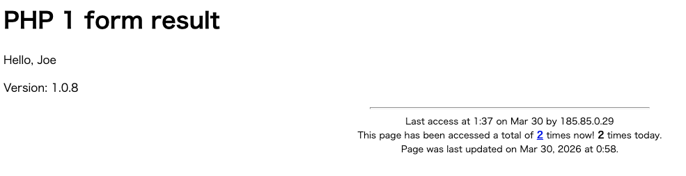
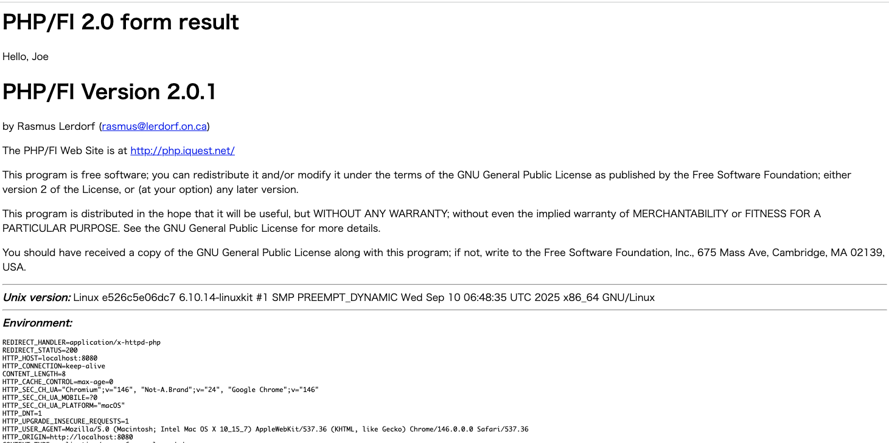
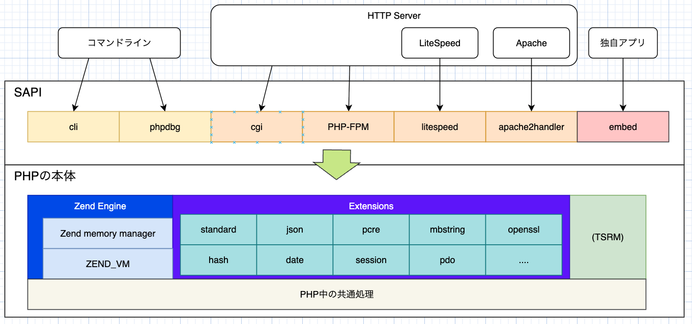

## はじめに
この記事は、10年ぶりくらいにPHPについて見直したため、その時のメモをまとめたものになります。

## 参考文献

**PHPに関するドキュメント**
- [PHPのコード](https://github.com/php/php-src)
- [PHPの言語仕様](https://github.com/php/php-langspec)
- [PHPの言語リファレンス](https://www.php.net/manual/ja/langref.php)
- [PHPの歴史](https://www.php.net/manual/ja/history.php.php)
- [PHP.net wiki](https://wiki.php.net/): PHP プロジェクト内部開発用
- [php museum](https://museum.php.net/): 古いPHPなどを置いてある

**書籍**

- [プログラミングPHP 第4版](https://learning.oreilly.com/library/view/puroguraminguphp-di-4ban/9784814400270/) April 2023
- [PHPクックブック ―モダンPHPによるWebアプリケーション実用レシピ集](https://learning.oreilly.com/library/view/phpkutukubutuku-modanphpniyoruwebapurikesiyonshi-yong-resipiji/9784814400621/) March 2024
- [Laravel: Up & Running, 3rd Edition](https://learning.oreilly.com/library/view/laravel-up/9781098153250/) September 2023

**PHPの内部情報を調べるための資料**
- [PHP Internals Book](https://www.phpinternalsbook.com/php7/introduction.html): PHPの内部の仕組みについての文章
- [PHP による hello world 入門](https://web.archive.org/web/20190401014431/http://tech.respect-pal.jp/php-helloworld/) webarchive.
- [PHP Internals and Virtual Machine](https://www.slideshare.net/slideshow/php-internals-and-virtual-machine/147416950)　slideshare
- [PHP, Under The Hood - DPC](https://www.slideshare.net/slideshow/php-under-the-hood-dpc/22603104)　slideshare
- **PHPコア開発者だったnikicのブログ**
  - [自己紹介](https://www.npopov.com/aboutMe.html)
  - [PHP 7 Virtual Machine](https://www.npopov.com/2017/04/14/PHP-7-Virtual-machine.html) 14. April 2017
  - [Internal value representation in PHP 7 - Part 1](https://www.npopov.com/2015/05/05/Internal-value-representation-in-PHP-7-part-1.html) 05. May 2015
  - [Internal value representation in PHP 7 - Part 2](https://www.npopov.com/2015/06/19/Internal-value-representation-in-PHP-7-part-2.html) 19. June 2015
  - [How opcache works](https://www.npopov.com/2021/10/13/How-opcache-works.html) 13. October 2021
  - [The opcache optimizer](https://www.npopov.com/2022/05/22/The-opcache-optimizer.html) 22. May 2022
  - [Early binding in PHP](https://www.npopov.com/2021/10/20/Early-binding-in-PHP.html) 20. October 2021
  - [Type variance in PHP](https://www.npopov.com/2021/11/08/Type-variance-in-PHP.html) 08. November 2021

## PHPの歴史

PHPは、PerlやPythonのようなプログラミング言語とは異なる生い立ちを持っています。
初期のPHPは、プログラミング言語というよりもCGI向けのツールであり、HTMLに埋め込まれた特定の記号をフォームの入力値などに置き換える、テンプレートエンジンのようなものでした。

後にPHP1といわれるものはRasmus Lerdorfにより[Personal Home Page Tools (PHP Tools)](https://groups.google.com/g/comp.infosystems.www.authoring.cgi/c/PyJ25gZ6z7A/m/M9FkTUVDfcwJ)という名前でリリースされたCGIバイナリのセットです。
このツールはアクセスカウンターやアクセスログを提供したり、フォームを簡単に作成して表示することができました。

以下はPHP1で作成したフォームのサンプルになります。

**form.html**

```html
<html>
  <body>
    <h1>PHP 1 form test</h1>
    <form action="/cgi-bin/phpl.cgi?form-result.html" method="POST">
      <input type="text" name="name" placeholder="name">
      <input type="submit">
    </form>
  </body>
</html>
```

**form-result.html**

```html
<html>
  <body>
    <h1>PHP 1 form result</h1>
    <p>Hello, <!--$name--></p>
    <p>Version: <!--$version--></p>
  </body>
</html>
```

このページは以下のように動作します。

1. form.htmlを表示して、submitを押す


2. form-result.html中の`<!--$name-->`と`<!--$version-->`を置き換えてレスポンスとして返す


その後、「Personal Home Page Tools (PHP Tools)」の名称が「Personal Home Page Construction Kit」となりました。
同時にSQLクエリの結果を表示する機能をいれてFI (Forms Interpreter)と名付けられたツールも作成されました。
後にPHP2といわれるPHP/FIはこれらのパッケージを書き直してまとめたものとなります。このころから単なるツールというよりはプログラミング言語へと進化し始めました。

以下はPHP/FI 2.0でのフォームの例になります。
このころには`.phtml`という拡張子を使用していたようです。

**form.html**

```html
<html>
  <body>
    <h1>PHP/FI 2.0 form test</h1>
    <FORM ACTION="form-result.phtml" METHOD=POST>
      <label>name</label>
      <INPUT TYPE="text" name="name"><br>
      <INPUT TYPE="submit">
    </FORM>
  </body>
</html>
```

**form-result.phtml**

```php
<html>
  <body>
    <h1>PHP/FI 2.0 form result</h1>
    <p>Hello, <?echo $name></p>
    <?phpinfo()>
  </body>
</html>
```



拡張子の違いはあるとはいえ、現在のPHPに近い書き方になっていることが確認できます。

PHP3のころにはPHP/FIがもっていた「Personal Home Page Construction Kit」という個人向けのイメージを払拭するために「PHP: Hypertext Preprocessor」という名前に変更されて、それの頭文字をとってPHPと呼称されました。これは頭字語の中に、その頭字語自身がもう一度出てくる再帰的頭字語になっています。

[PHP4.3](https://www.php.net/releases/4_3_0.php)になると、コマンドラインインターフェイスがサポートされ、シェルアプリケーションやデスクトップアプリケーションの開発が可能になりました。

その後、PHP 5、PHP 7、PHP 8と進化していきます。
なお、PHP6についてはPHP 5.3の次のバージョンとして計画されていましたが、PHP6で予定していた機能は5.4, 5.5で取り込まれたため、PHP6については欠番になりました。

## PHP8時点の概要

以下はPHP概要図は以下のようになります。[^1]



PHP8時点でPHPはコマンドラインや、Webサーバーからさまざまな方法で使用されます。
コマンドラインやWebサーバーからの呼び出しはserver application programming interface (SAPI)[^2]という層を経由してPHPの本体と連携します。

SAPIは次のようなものが存在します。

- コマンドラインからの実行
  - cli
  - phpdbg
- WebServerからの実行
  - cgi
    - Webリクエストが来るたびに、Web サーバーがPHP-CGI プロセスを起動してリクエストを処理する方式
    - HTTPのリクエストを標準入力と環境変数を使ってPHPーCGIプロセスに渡し、その標準出力をHTTPレスポンスとする
    - CGIについての詳しい仕様は[RFC 3857  The Common Gateway Interface (CGI) Version 1.1](https://www.rfc-editor.org/rfc/rfc3875)を参照
  - PHP-FPM
    - PHP-FPM（FastCGI Process Manager）プロセスを起動してリクエストを処理する方式
    - PHP-FPMプロセスとソケット通信をおこないHTTPリクエストを渡しとレスポンスを取得する
    - FastCGIの詳しい仕様は[FastCGI Specification](https://fast-cgi.github.io/spec)参照のこと
  - apache2handler
    - [Apache](https://httpd.apache.org/)のモジュールとしてPHPを組み込む方法
    - mod_phpとも言われる方式でApacheのプロセス内でPHPが実行されることになる
  - litespeed
    - [litespeed](https://www.litespeedtech.com/products/litespeed-web-server)用のPHPの連携方法
    - [FastCGIと似たアーキテクチャでPHPとlitespeedを繋げている](https://github.com/php/php-src/tree/master/sapi/litespeed)
- 独自アプリケーション
  - embed
    - 独自のアプリケーション中でPHPを組み込む場合に利用するSAPI

PHPの本体には主に次のようなグループがあります。

- Zend Engine[^3]
  - PHP言語をコンパイルして実行する環境。
- Extensions
  - 拡張機能。PHPの場合、ファイル、文字列、配列、入出力などの基本関数、JSONや日付処理からpdoによるDBアクセスなどの機能は拡張機能として実装されている。
- TSRM(Thread Safe Resource Manager)
  - ZTSモードの場合のみスレッドセーフなリソースを管理する機能を提供する

## 最近のPHPに追加された機能

### 

[^1]: いくらか書籍を読んでもPHPの概念図的なものはなかったため、[PHPのコード](https://github.com/php/php-src)や[PHP Internals Book](https://www.phpinternalsbook.com/php7/introduction.html)、そしてPHPの内部情報を調べるための資料を読んで作成したものになります。そのため、単純化しいたり、実態を表していない可能性があります。
[^2]: [1998年1月にSAPIの実装が報告されました](https://marc.info/?l=php-internals&m=90279104406739&w=2)。これによりサーバー固有のコードをPHPコアコードから分離できるようなりました。当時はISAPI(Internet Server Application Programming Interface: IIS用の拡張API)、NSAPI(Netscape Enterprise Server 系のサーバー拡張API)などが存在しました。
[^3]: PHP4以降にZeev Suraski氏とAndi Gutmans氏が開発したからZendと呼ばれるようです。
